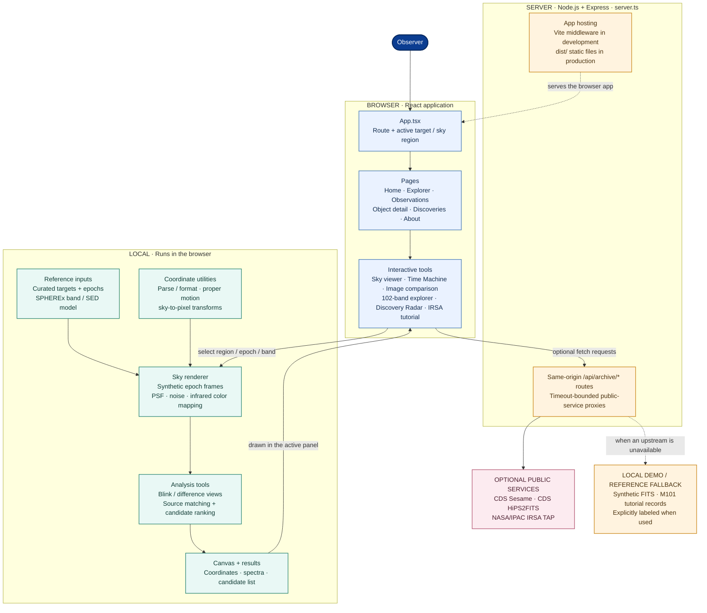
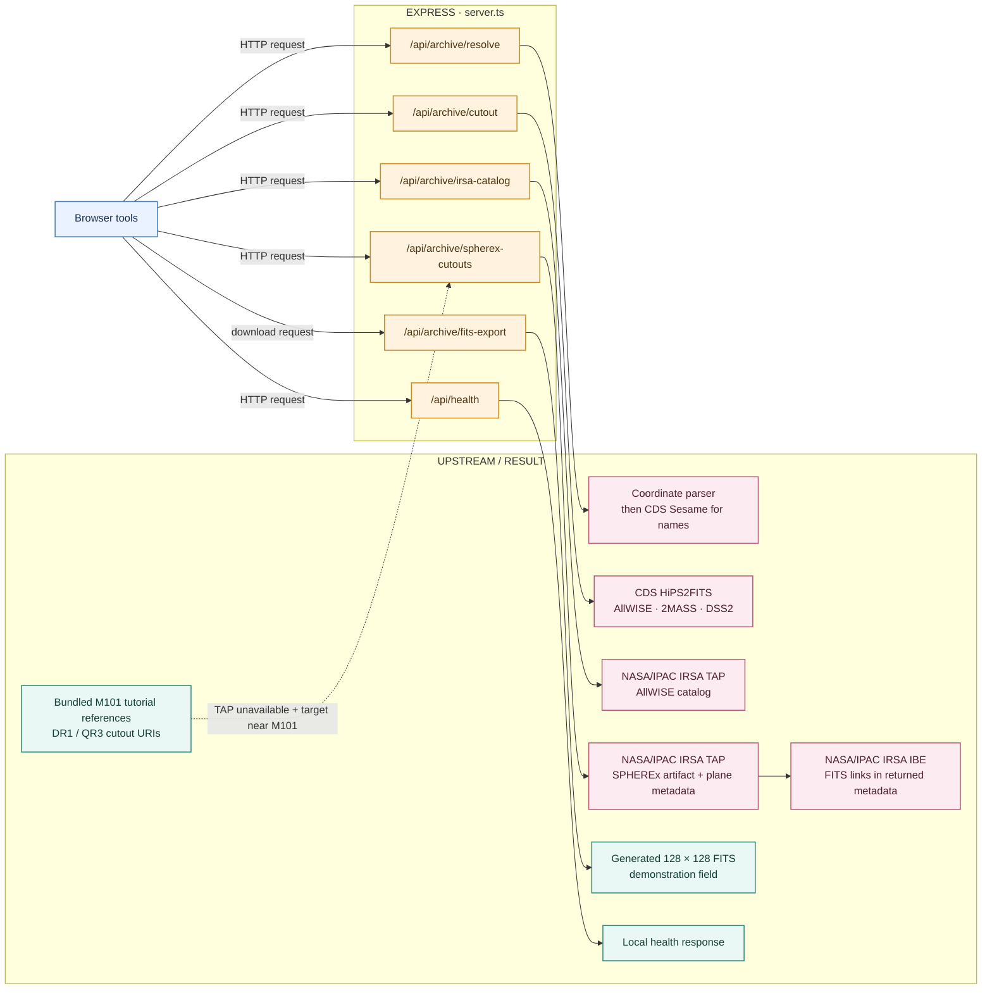

# AFTERLIGHT

### Explore the changing infrared universe — one observation at a time

**A NASA Space Apps Challenge 2026 project · Planet X and SPHEREx**

AFTERLIGHT is an interactive astronomical exploration workbench for studying how celestial objects move and change brightness across observation epochs and infrared wavelengths. It combines a high-performance sky viewer, a 102-band SPHEREx reference model, public archive integrations, and a moving-object candidate pipeline into one browser-based experience.

> **Project status:** Challenge prototype / research and education interface. Several sky plates, spectra, and epochs are deterministic demonstrations rather than downloaded science products. Candidate detections are unconfirmed and are not verified astronomical discoveries.

---

## Table of contents

- [Features](#features)
- [System architecture](#system-architecture)
- [Installation](#installation)
- [Quickstart](#quickstart)
- [Configuration](#configuration)
- [Usage examples](#usage-examples)
- [Science and analysis features](#science-and-analysis-features)
- [Development and testing](#development-and-testing)
- [Project structure](#project-structure)
- [Data and scientific integrity](#data-and-scientific-integrity)
- [Contributing](#contributing)
- [License](#license)
- [Acknowledgements](#acknowledgements)

---

## Features

- **Interactive sky plate viewer:** Pan and zoom across deep-space infrared plates, inspect real-time cursor coordinates in sexagesimal and decimal formats, and toggle WCS-aligned grids.
- **Multi-epoch time travel:** Step or animate through curated observation epochs to visualize modeled proper motion, astrometric displacement, and stellar brightness changes over years.
- **Epoch comparison & blinking:** Inspect side-by-side frames, blink between two epochs at configurable frequencies, or compute a signed difference image to highlight subtle transients.
- **102-band SPHEREx spectrometer:** Explore all 102 channels across 6 detector arrays spanning 0.75 to 5.00 µm, with reference spectral energy distribution (SED) models and molecular absorption lines (H₂O ice, CO₂, CO, PAHs).
- **Discovery Radar pipeline:** Automatically extract point sources, compute intensity-weighted centroids, subtract stationary stars, and score displaced candidate moving objects with SNR and confidence metrics.
- **Public archive lookups:** Query live CDS Sesame for celestial name resolution, CDS HiPS2FITS for multi-survey imagery (AllWISE, 2MASS, DSS2), and NASA/IPAC IRSA TAP for AllWISE and SPHEREx catalogs.
- **Scientific data export:** Save canvas views as PNG or request standards-compliant 128 × 128 demonstration FITS files complete with WCS and celestial coordinate headers.

---

## System architecture

AFTERLIGHT executes along two coordinated layers: **client-side computation and rendering in the browser** and **archive query routing through Express**.



### Archive request paths

Each endpoint is isolated with bounded timeouts and transparent demo fallbacks:



---

## Installation

### Prerequisites

- **Node.js**: `v20.19+` or `v22.12+` (compatible with Vite 8)
- **Package manager**: `npm` (v10+) or `bun`

### Setup steps

Clone the repository and install the project dependencies:

```bash
git clone https://github.com/Ebenezer-03/Afterlight.git
cd Afterlight
npm install
```

---

## Quickstart

Start the local development server with tsx and Vite:

```bash
npm run dev
```

Once running, navigate to `http://localhost:3000` in your web browser. The Express server serves as the application entry point and proxies archive queries while mounting Vite as development middleware.

---

## Configuration

AFTERLIGHT works offline out of the box using built-in demonstration models. To configure optional parameters and external integrations, create a `.env` file from the example template:

```bash
cp .env.example .env
```

| Environment variable | Default | Description |
| --- | --- | --- |
| `PORT` | `3000` | Port on which the Express application server listens. |
| `NODE_ENV` | `development` | Set to `production` to serve static compiled assets from `dist/`. |
| `GEMINI_API_KEY` | _None_ | Optional API key for server-side Gemini astronomical insight calls. |
| `APP_URL` | `http://localhost:3000` | Public host URL used for self-referential links and callbacks. |

---

## Usage examples

### 1. Resolve and view target coordinates

In the **Explorer** view, search by target identifier (such as `Barnard's Star` or `M101`) or enter J2000 sexagesimal coordinates (`17h 57m 48.5s +04d 41m 36s`). The system converts positions to small-field tangent plane coordinates and streams synthetic infrared observation frames.

### 2. Blink and differentiate multi-year epochs

Switch to the **Comparison** tool:
1. Select two baseline epochs (e.g., `WISE 2010` and `NEOWISE 2024`).
2. Toggle the **Blink** comparator at 2 Hz to visually identify displaced sources.
3. Switch to **Difference Mode** to compute a pixel-level signed subtraction matrix ($\Delta I = I_{t2} - I_{t1}$).

### 3. Run automated candidate extraction

Open the **Discovery Radar**:
1. Choose an observation pair and click **Run Detection**.
2. The pipeline computes background noise ($\sigma$), identifies intensity peaks ($>5\sigma$), extracts centroids, and cross-matches static stars.
3. Review the candidate list sorted by displacement and assign review flags (`Candidate`, `Artifact`, `Known Object`).

---

## Science and analysis features

### Sky coordinates and proper motion
Implemented in `src/lib/astronomy.ts`:
- Parses decimal and sexagesimal right ascension and declination.
- Computes great-circle angular distances using the Haversine formula.
- Propagates astrometric proper motion vectors across arbitrary time deltas.
- Maps equatorial sky coordinates to viewer pixel buffers using local WCS tangent projections.

### Synthetic observation renderer
Implemented in `src/lib/skyRenderer.ts`:
- Generates reproducible infrared sky fields from coordinate seeds into high-precision `Float32Array` buffers.
- Simulates Point Spread Functions (PSFs), wavelength-dependent stellar fluxes, and infrared sky grain.
- Renders final canvas frames using an asinh non-linear luminance stretch with false-color palettes.

### SPHEREx 102-band reference model
Implemented in `src/lib/spherex.ts`:
- Models all six SPHEREx linear variable filter (LVF) arrays across 0.75–5.00 µm with 102 discreet channels.
- Calculates synthetic Spectral Energy Distributions (SEDs) for stellar types, active galactic nuclei, and brown dwarfs.
- Overlays characteristic infrared absorption bands including Water Ice (3.05 µm), CO₂ (4.27 µm), and CO (4.67 µm).

### Discovery Radar pipeline
Implemented in `src/lib/detection.ts`:
- Performs spatial local background estimation and threshold clipping.
- Calculates sub-pixel centroids using intensity-weighted moments.
- Cross-matches stationary sources within a configurable pixel radius ($\sim 2.5$ px).
- Isolates high-displacement residuals, computes Signal-to-Noise Ratios (SNR), and assigns confidence scores.

### Archive and export API
Implemented in `server.ts`:

| Endpoint | HTTP Method | Description |
| --- | --- | --- |
| `/api/health` | `GET` | Health status and server uptime timestamp. |
| `/api/archive/resolve` | `GET` | Coordinate parsing with CDS Sesame name resolution fallback. |
| `/api/archive/cutout` | `GET` | CDS HiPS2FITS cutout proxy (AllWISE, 2MASS, DSS2). |
| `/api/archive/irsa-catalog` | `GET` | NASA/IPAC IRSA TAP query for AllWISE point source catalogs (`allwise_p3as_psd`). |
| `/api/archive/spherex-cutouts` | `GET` | SPHEREx TAP cutout and observation metadata query. |
| `/api/archive/fits-export` | `GET` | Generates a 128 × 128 demonstration FITS image with valid celestial headers. |

---

## Development and testing

### Type checking and linting

Run TypeScript type check without emitting output:

```bash
npm run lint
```

### Automated test suite

Execute the unit and integration tests covering coordinate transforms, candidate matching, and SPHEREx spectral models:

```bash
npx tsx --test src/lib/astronomy.test.ts src/data/spherexTutorialDataset.test.ts
```

### Production build

Compile the frontend assets into the `dist/` directory:

```bash
npm run build
```

Serve the production build via Express:

```bash
npm start
```

---

## Project structure

```text
.
├── server.ts                     # Express API, archive proxies, FITS generator, Vite host
├── index.html                    # HTML entry point and application shell
├── vite.config.ts                # Vite build and plugin configurations
├── package.json                  # Dependencies and run scripts
├── tsconfig.json                 # TypeScript compiler configuration
├── metadata.json                 # AI Studio & NASA Space Apps metadata
├── src/
│   ├── main.tsx                  # React application bootstrap
│   ├── App.tsx                   # Top-level state, router, and target resolution
│   ├── index.css                 # Tailwind CSS v4 styling rules
│   ├── assets/images/            # Reference plates and M101 preview images
│   ├── components/               # UI components (Sky Viewer, Timeline, Radar, Panels)
│   ├── data/
│   │   ├── objects.ts            # Curated astronomical targets and epoch catalog
│   │   └── spherexTutorialDataset.ts # IRSA SPHEREx tutorial cutouts and TAP queries
│   ├── lib/
│   │   ├── astronomy.ts          # Astrometry, coordinate transforms, proper motion
│   │   ├── detection.ts          # Moving source detection and candidate ranking
│   │   ├── skyRenderer.ts        # Synthetic infrared frame canvas renderer
│   │   ├── spherex.ts            # 102-band spectrometer and SED reference calculations
│   │   └── lenisContext.tsx      # Smooth-scrolling provider
│   └── pages/                    # Home, Explorer, Observations, Detail, Discoveries, About
└── README.md
```

---

## Data and scientific integrity

- **Synthetic vs. Archival Data:** The app visualizes locally synthesized infrared sky plates and modeled SED curves for educational exploration. While it queries real catalog metadata, rendered images are not raw astronomical telemetry.
- **SPHEREx Scope:** Models the 6-array, 102-channel instrument layout and IRSA metadata schemas. It does not ingest multi-gigabyte raw mission FITS cubes in the browser.
- **Candidate Verification:** Moving-object detections generated by the Discovery Radar are unconfirmed anomalies. Real astronomical discoveries require multi-night astrometric verification and follow-up observations.
- **Service Availability:** Network requests to external servers (CDS, IRSA) operate with strict timeouts and automatically display labeled fallback data when unavailable.

---

## Contributing

Contributions are welcome! Please follow these steps to contribute:

1. **Fork the repository** on GitHub (`https://github.com/Ebenezer-03/Afterlight`).
2. **Create a feature branch:**
   ```bash
   git checkout -b feature/your-feature-name
   ```
3. **Commit your changes:** Follow [Conventional Commits](https://www.conventionalcommits.org/) format:
   ```bash
   git commit -m "feat: add support for custom FITS file upload"
   ```
4. **Run tests and linters:** Ensure all tests pass:
   ```bash
   npm run lint
   ```
5. **Push and open a pull request:** Push your branch and open a PR against the `main` branch.

---

## License

This project is open-source and licensed under the [MIT License](LICENSE).

---

## Acknowledgements

- **NASA Space Apps Challenge 2026** — *Planet X and SPHEREx* challenge track.
- **NASA / JPL-Caltech** for the SPHEREx mission concepts and infrared science data.
- **Caltech/IPAC IRSA** for the [SPHEREx Cutouts Tutorial](https://caltech-ipac.github.io/irsa-tutorials/spherex-cutouts/) and TAP interfaces.
- **CDS Strasbourg** for CDS Sesame and HiPS2FITS sky survey access.
